

<picture><source media="(prefers-color-scheme: dark)" srcset="assets/hero-dark.svg"></picture>

<picture><source media="(prefers-color-scheme: dark)" srcset="assets/social-l-dark.svg"></picture><a href="https://t.me/blake22020"><picture><source media="(prefers-color-scheme: dark)" srcset="assets/social-1-dark.svg"></picture></a><a href="https://discord.com/blake10110"><picture><source media="(prefers-color-scheme: dark)" srcset="assets/social-2-dark.svg"></picture></a><picture><source media="(prefers-color-scheme: dark)" srcset="assets/social-r-dark.svg"></picture>

<picture><source media="(prefers-color-scheme: dark)" srcset="assets/about-dark.svg"></picture>

<picture><source media="(prefers-color-scheme: dark)" srcset="assets/stack-dark.svg"></picture>

<a href="https://github.com/Blake22020/GBlake"><picture><source media="(prefers-color-scheme: dark)" srcset="assets/project-gblake-dark.svg"></picture></a>&nbsp;<a href="https://github.com/Blake22020/LexiGo"><picture><source media="(prefers-color-scheme: dark)" srcset="assets/project-lexigo-dark.svg"></picture></a>

<a href="https://github.com/Blake22020/BlakeRandom"><picture><source media="(prefers-color-scheme: dark)" srcset="assets/project-blakerandom-dark.svg"></picture></a>&nbsp;<a href="https://github.com/Blake22020/callous"><picture><source media="(prefers-color-scheme: dark)" srcset="assets/project-callous-dark.svg"></picture></a>

<picture><source media="(prefers-color-scheme: dark)" srcset="assets/stats-dark.svg"></picture>

<picture><source media="(prefers-color-scheme: dark)" srcset="assets/streak-dark.svg"></picture>

<picture><source media="(prefers-color-scheme: dark)" srcset="assets/wave-dark.svg"></picture>

<a href="https://github.com/blake22020?tab=repositories"><picture><source media="(prefers-color-scheme: dark)" srcset="assets/button-1-dark.svg"></picture></a>

